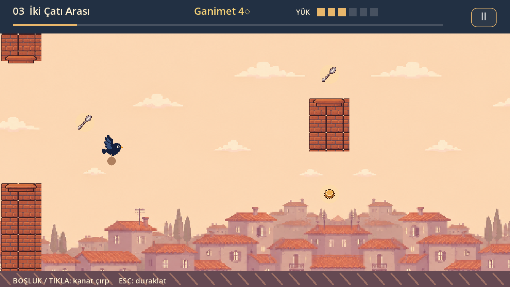
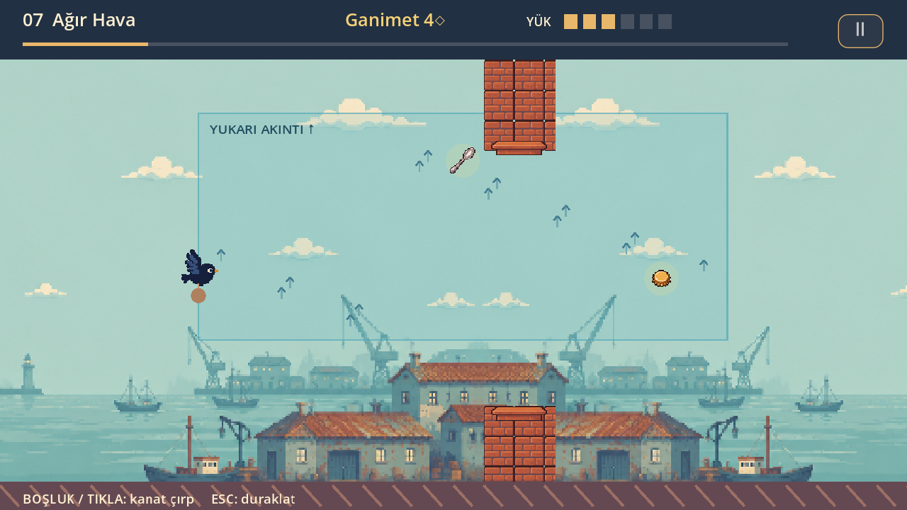
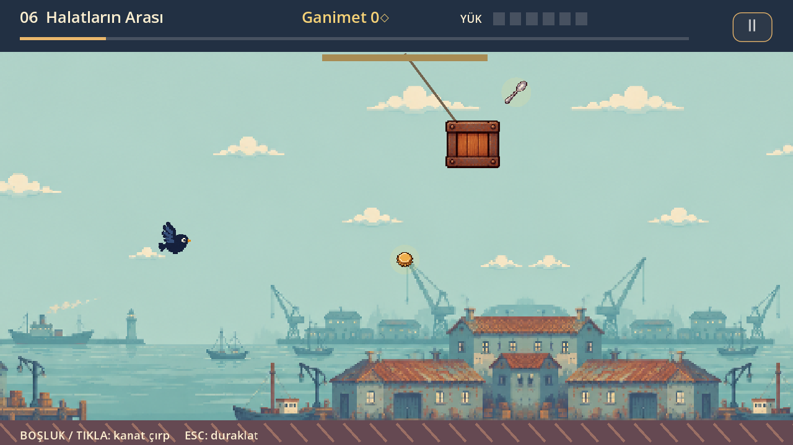
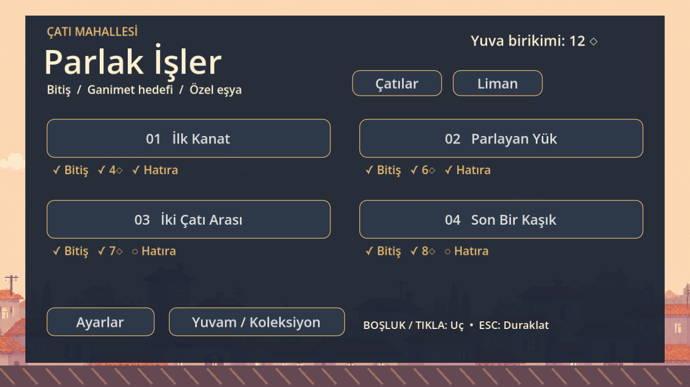
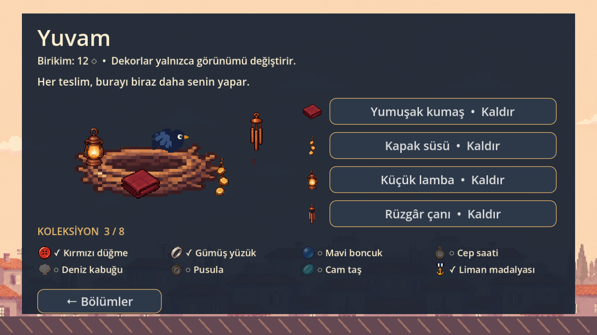
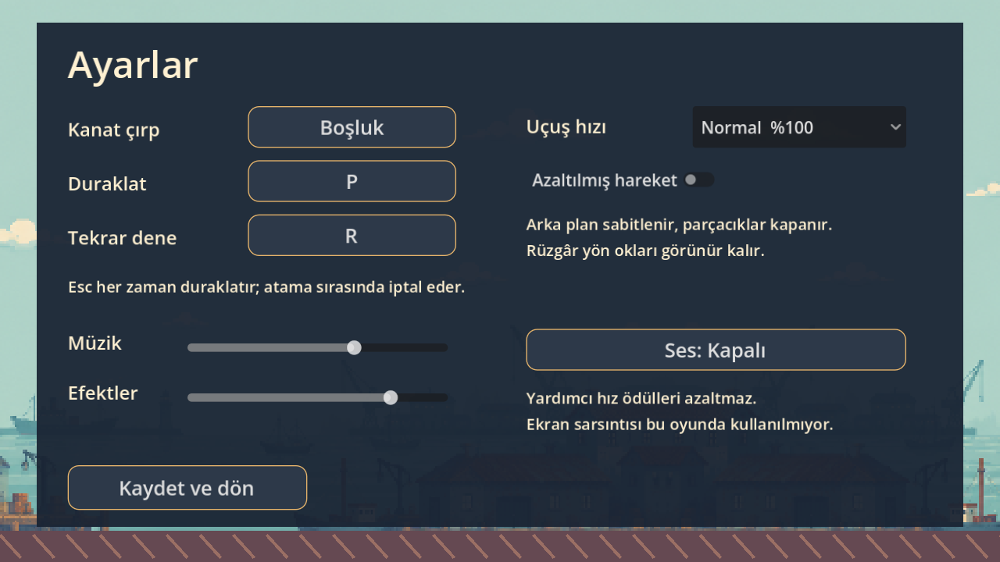

# Parlak İşler

**Bir karga, bir avuç parlak eşya ve “bir tane daha alayım mı?” kararı.**

Parlak İşler, Godot ile geliştirilen iki boyutlu bir uçuş oyunudur. Flappy Bird’ün tek tuşla kanat çırpma fikrini ganimet toplama, yük yönetimi ve yuvaya dönme kararıyla birleştirir. Sıcak renkli çatılardan rüzgârlı limana uzanan yolculukta kapaklar, kaşıklar ve özel hatıralar toplarsın; kazandıklarınla yuvanı süslersin.

## Nasıl oynanır?

Karga kendiliğinden ileri gider. Kanat çırparak yüksekliğini ayarla, engellerden kaç ve istediğin ganimete yönel. Kapak hafiftir; kaşık daha değerlidir ama daha ağırdır. Kesen doldukça uçuş zorlaşır: her parlayan eşya küçük bir risk kararıdır.

- **Yük kapasitesi:** 6 birim. Kapak 1 yük / 1 değer, kaşık 2 yük / 3 değer taşır.
- **Ara yuva:** Taşıdıklarını güvenceye alıp uçuşu erken bitirir. Sonraki bölümü açmaz.
- **Son yuva:** Bölümü tamamlar ve sıradaki rotayı açar. Tamamlamak için ganimet hedefini tutturmak zorunlu değildir.
- **Çarpışma:** O uçuşta taşıdıklarını kaybedersin; önceki teslimlerin korunur.
- **Hatıralar:** Her bölümün kendine özgü özel eşyası vardır. Koleksiyona eklenmesi için yuvaya teslim etmelisin.
- **Yuvam:** Birikiminle dört dekor satın alıp yerleştirebilirsin. Dekorlar yalnızca görünümü değiştirir.

Her bölümde bitiş, ganimet hedefi ve özel eşya ayrı ayrı takip edilir. Böylece ilk hedefin güvenle dönmek, sonraki denemelerinin hedefi ise daha iyi bir teslim yapmak olabilir.

## İki bölge, sekiz bölüm

| Bölge | Bölümler | Oynanış |
|---|---|---|
| Çatı Mahallesi | İlk Kanat · Parlayan Yük · İki Çatı Arası · Son Bir Kaşık | Uçuş ritmi, yükün etkisi, güvenli ve riskli geçişler, teslim kararı |
| Rüzgârlı Liman | Esinti · Halatların Arası · Ağır Hava · Limanın Hazinesi | Yukarı/aşağı akıntılar, sallanan yükler ve bu mekaniklerin birlikte kullanımı |

Liman, **Son Bir Kaşık** bölümünün son yuvasına ulaştığında açılır. Piksel sanatında çatılar sıcak gün batımı tonları, liman ise mavi ve yeşil tonları kullanır.

### Limanda rüzgâr

Yön okları akıntının etkisini gösterir. Topladığın yükle birlikte uçuş ritmini yeniden ayarlaman gerekir.

### Halatların arasında

Sallanan yükler geçiş aralığını zamanla değiştirir; ganimete yaklaşırken engelin hareketini de okumalısın.

## Menüler

### Bölüm seçimi

İki bölge arasında geçiş yapabilir, her rotadaki üç hedefin durumunu görebilirsin.

### Yuvam ve koleksiyon

Her teslim, geri döneceğin yeri biraz daha kişiselleştirir. Hatıralar sekiz bölümlük yolculuğunun kalıcı izidir.

### Ayarlar

Tuşları değiştirebilir, müzik ve efekt düzeylerini ayrı ayarlayabilir, %75 veya %50 yardımcı hız seçebilirsin. Yardımcı hız ödülleri azaltmaz. Azaltılmış hareket seçeneği arka plan kaymasını ve parçacıkları kapatır; rüzgârın yön okları görünür kalır.

Görseller 0.3.0 sürümünün gerçek Godot ekranlarından 1280×720 çözünürlükte alınmıştır. Çekim için bölüm konumları ve örnek ilerleme bellekte hazırlanmıştır; oyuncu kaydı değiştirilmemiştir. Yeniden üretme betiği: [tests/readme_screenshots.gd](tests/readme_screenshots.gd).

## Kontroller

| Eylem | Varsayılan kontrol |
|---|---|
| Kanat çırp / uçuşu başlat | Boşluk veya sol fare tıklaması |
| Duraklat | P veya Esc |
| Sonuç ekranında tekrar dene | R |

Tuş atamaları Ayarlar’dan değişir; Esc her zaman duraklatır. Pencere odağını kaybedince oyun otomatik duraklar.

## Çalıştırma

### Godot projesi

1. Godot’u aç. Proje **Godot 4.7.2** ile geliştirilip doğrulandı.
2. Proje yöneticisinde **İçe Aktar** ile bu klasördeki `project.godot` dosyasını seç.
3. Projeyi açıp **F5** ile çalıştır.

### Yerel macOS paketi

Bu çalışma alanında üretilen `builds/Parlak Isler.app` dosyasını açabilirsin. `builds/Parlak-Isler-0.3.0-macOS.zip` aynı paketin arşividir. Paket kendi Godot çalıştırıcısını içerir; ayrıca Godot kurulumu gerektirmez.

`builds/` sürüm kontrolüne dahil değildir. Paketi yeniden üretmek için `python3 tools/build_macos.py` kullanılır; betikteki Godot yolunun makinenle eşleşmesi gerekir. Paket Apple Silicon ve Intel mimarilerini içerir; çalışma testi Apple M3 Max üzerinde yapıldı. Yerel ad-hoc imzalı test paketidir; Apple noter onayı henüz yoktur.

İlerleme otomatik kaydedilir. macOS kayıt konumu: `~/Library/Application Support/Godot/app_userdata/Parlak İşler/ilerleme.json`.

## Vibecoding ile geliştirme

Bu proje **Codex ile vibecoding** yaklaşımıyla geliştirildi. Oyun fikri, kapsamı ve yönlendirmeler Türkçe doğal dil üzerinden verildi; Codex bu yönlendirmeleri tasarım belgelerine, Godot/GDScript uygulamasına, bölüm verilerine, otomatik kontrollere ve paketleme araçlarına dönüştürdü. Geliştirme üç faz boyunca geri bildirimlerle ilerledi.

Karga, çatılar, liman, ganimetler, yuvalar, hatıralar ve dekorların görselleri **Higgsfield** üzerinden üretildi; proje için işlenip Godot’a eklendi. Sanat yaklaşımı [art_direction.md](art_direction.md), üretim kaynakları [assets/manifest.json](assets/manifest.json) içinde kayıtlıdır. Müzik ve efektler proje için sentezlendi.

## Geliştirme durumu ve yeni bölümler

**0.3.0 yerel test sürümü:** Sekiz bölüm, iki bölge, koleksiyon, dekorlar, ayarlar ve kalıcı kayıt oynanabilir durumdadır. Mevcut otomatik doğrulamada **132 kontrol geçti**; bunlara sekiz bölümün yedi farklı yük seviyesiyle toplam 56 uçuşu dahildir. İnsan oyuncu testleri henüz yapılmadı; zorluk eğrisi ve dekor fiyatları oyuncu geri bildirimine açıktır.

Bölümler `data/levels/` altındaki JSON dosyalarından ve `data/level_catalog.json` kataloğundan yüklenir. Mevcut mekanikleri kullanan yeni bir rota, bölüm verisi ve katalog girdisi eklenerek güncelleme olarak sunulabilir. Yeni mekanikler ayrıca kod geliştirmesi gerektirir. Veriyle dokuzuncu bölüm ekleme yolu otomatik testle doğrulandı; mevcut oyuncu kataloğunda sekiz bölüm vardır.

| Belge | İçerik |
|---|---|
| [prd.md](prd.md) | Oyun tasarımı ve MDA framework’ü |
| [plans.md](plans.md) | Üç fazın görevleri, ilerleme ve açık işler |
| [player_journey.md](player_journey.md) | Bölümlerin hedeflediği oyuncu deneyimi ve duygular |
| [art_direction.md](art_direction.md) | Görsel stil ve sanat üretimi |
| [architecture.md](architecture.md) | Teknik yapı ve bölüm ekleme yaklaşımı |
| [RELEASE_NOTES.md](RELEASE_NOTES.md) | 0.3.0 sürüm ayrıntıları ve bilinen sınırlar |
